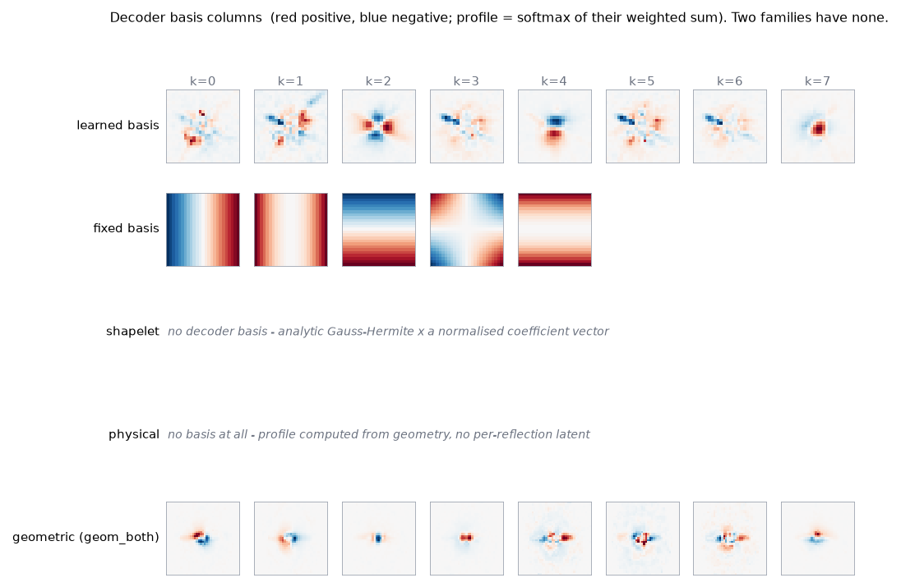
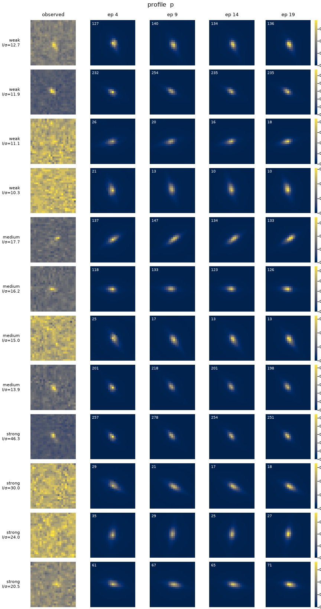

# Profile models

The profile `π` is the one latent the intensity cannot be identified without.
This collects the five families in the codebase, the mathematics each imposes, what each can and cannot represent, and how they compare once scored through an export that actually depends on them.

## 1. Why the profile is the load-bearing part

The pixel model is

$$ c_p \sim \mathrm{Poisson}\!\left(I\,\pi_p + b_p\right), \qquad \sum_p \pi_p = 1 $$

and the intensity is **not identified by the data alone**.
For any $f \in (0,1]$ the substitution

$$ \pi' = \frac{f}{f'}\pi + \left(1 - \frac{f}{f'}\right)u, \qquad u_p = 1/P $$

gives an identical likelihood at every signal level, with $I$ absorbing the change.
So $I$ is pinned **only** by which profiles the family admits.
A family with per-reflection freedom in the uniform direction $u$ and the delta direction leaves $I$ unidentified — and an unconstrained `softmax(Wh + b)` falls into both attractors in practice.

Two consequences shape every design below.

**The gauge.** `softmax(Wh + b)` is invariant under $h \to h/c,\ W \to cW$.
Nothing then pins the scale of $h$, so the KL weight, the prior scale, and any penalty written in terms of $W$ are **not well-posed quantities**.
This is why `prior_scale` behaved as a gauge in the earlier τ sweep and why that sweep could never have worked.

**Peakedness is worth real SNR in Laue.** Laue shoeboxes are 96.6% background against 0% for monochromatic 9b7c, so profile peakedness is worth about 3.4× in SNR here and essentially nothing in mono.
A flat profile makes the integrated intensity the full-box sum, which is what the weak-spot plateau pathology is.

## 2. The five families

### 2.1 Learned basis — `learned_basis_profile`

$$ \pi = \mathrm{softmax}(W h + b), \qquad h \sim q(h \mid \text{counts}) = \mathcal{N}(\mu, \sigma), \qquad h \sim \mathcal{N}(0, \tau) \ \text{(prior)} $$

$W \in \mathbb{R}^{P \times d}$ is learned, $h$ is inferred per reflection from that reflection's own pixels.
Carries the gauge above.
Its failure mode is specific: when the counts cannot constrain $h$, the KL drives $h \to 0$ and **every such reflection gets `softmax(b)`** — one profile shared by the whole dataset.
On Laue stills that is an azimuthal average of radial streaks, so it is round where the data is elongated.

### 2.2 Fixed basis — `fixed_basis_profile`

Identical form with $W$ **frozen** to an analytic polynomial family (Hermite/monomial).
Freezing removes the gauge and puts $h$ in logit units, so the KL weight and prior scale become meaningful for the first time.
It also bounds reachability: with quadratic columns the family is the anisotropic Gaussians, so a near-delta needs a coefficient of order $P^{2/3}$ logits and uniform needs every coefficient at zero.

### 2.3 Shapelet — `shapelet_profile`

A squared Gauss–Hermite expansion in a geometry-aligned anisotropic frame:

$$ \pi \propto \left(\sum_k c_k \Phi_k\right)^{2}, \qquad c = \frac{(1, \epsilon)}{\sqrt{1 + \lVert\epsilon\rVert^2}}, \qquad \epsilon \sim q $$

Three properties the learned softmax lacks:

- **It cannot be uniform or a near-delta.** The Gaussian envelope bounds the support from above and the Christoffel inequality $\pi \le \sum_n \phi_n^2$ bounds the peak from below, so both softmax attractors are *outside the family*. Truncation order alone does not do this — the envelope and the order-decaying prior do.
- **It has no gauge.** The basis is analytic and $c$ is normalised with $c_0$ fixed at 1, so the $h \to h/c$ freedom is gone.
- **Its coefficients mean something.** Order 1 is a centroid shift, order 2 an ellipticity, order 3 the skew — which is what a wavelength-dependent Laue streak needs and a symmetric Gaussian cannot express. Each order gets its own prior width $\tau_n = \tau_0 (1+n)^{-\text{decay}}$; the decay is load-bearing, since a flat prior across orders re-admits the degeneracy as order rises.

The frame (azimuth, centre, two extents) is predicted from detector geometry rather than inferred per reflection, because a free per-reflection scale re-admits the non-identification the analytic basis removes.

### 2.4 Physical — `physical_profile`

No per-reflection latent and no basis matrix at all.
Each profile is **computed** from that reflection's geometry; the only learned quantities are a handful of numbers shared across the dataset, which the bright reflections pin down.
The form is what convolution of near-Gaussian kernels gives:

$$ \sigma_{\text{tangential}}^2 = a\sin^2\theta + b, \qquad \sigma_{\text{radial}}^2 = a\sin^2\theta + b + c $$

$a$ carries the mosaic spread, $b$ the angle-independent terms, and $c$ the wavelength spread, which acts **radially only** and is therefore zero for monochromatic data.
Measured on bright reflections this holds with $R^2$ 0.96–0.97 on HEWL Laue and 0.56–0.59 on monochromatic HEWL; the fitted radial excess is 2.59 px² on Laue against 0.06 px² mono, which is exactly what $c$ represents.

### 2.5 Geometric — `geometric_basis_profile` (`geom_both`)

The learned basis with a **local** weak-reflection fallback instead of a global one, reusing the existing basis rather than replacing it:

- `local_shift`: $\text{logits} = (h + m(s)) W^\top + b$, with $m(s)$ a small MLP of the detector geometry $s$. A weak reflection falls back to $\mathrm{softmax}(m(s)W^\top + b)$ — the profile typical of *its position on the detector* rather than of the whole dataset.
- Coordinate channels (`profile_coord_channels`) are the alternative route, concatenating beam-centred radial/tangential coordinates onto the encoder input.

These two are not equivalent, and the measurement below separates them sharply.

## 3. What each family produces on real data

The first eight decoder columns per family, red positive and blue negative; the profile is the softmax of their weighted sum.
The learned basis has no imposed structure; the fixed and analytic families show the polynomial/Hermite orders explicitly.

In the basis panel, two families are deliberately blank: the shapelet expands an
analytic Gauss-Hermite basis against a normalised coefficient vector, and the
physical surrogate computes the profile from geometry with no per-reflection
latent at all.
Neither has a decoder matrix to show, which is the property that removes the gauge.
The learned basis's columns are unstructured; the fixed basis shows its polynomial
orders explicitly (linear in x, linear in y, the quadratics and the saddle);
`geom_both`'s are structured and localised.

### Profiles over training, per signal regime

Produced with the project's figure suite (`scripts/make_training_figures.py`,
Route B replay over the saved checkpoints), which runs the real data pipeline
and a frozen-and-restored RNG so frame-to-frame change is the model rather than
MC noise. The number in each panel's corner is `n_eff = 1/sum(pi^2)`, the
effective pixel count.

**Learned basis**

**Geometric (`geom_both`)**

Both produce compact, peaked profiles -- not the near-uniform collapse that a
missing warm-start would give. Two differences matter:

*The learned basis has not converged in 20 epochs.* Its `n_eff` falls
monotonically right through the last checkpoint -- 302 -> 268 -> 179 -> 147 on
one tracked reflection, 98 -> 41 -> 22 -> 17 on another -- so the profile is
still sharpening when training stops. `geom_both` settles by epoch 4 and holds
(127 -> 140 -> 134 -> 136; 232 -> 254 -> 235 -> 235).

*`geom_both` is anisotropic and per-reflection oriented; the learned basis is
not.* The geometric profiles are elongated along directions that differ from
reflection to reflection and follow the streaks in the observed panels, which
is what `local_shift` supplies. The learned basis produces a roughly round
profile regardless.

Together these suggest the learned basis may be losing on **training budget**
rather than on family: 20 epochs is not enough for it to converge, while the
geometry-conditioned families start near the right answer. That is a cheaper
and more testable explanation than a family-level deficiency, and it is
consistent with `geom_both` placing 2nd under the Kabsch export despite sharing
the same decoder machinery.

**Correction.** An earlier version of this section showed a hand-plotted figure
in which the learned basis produced a broad, round, signal-independent blob,
and built an argument about profile collapse on it. That figure was wrong: it
was generated by hand-feeding the encoder, applying only the Anscombe transform
while the real data module also standardises with stored per-dataset statistics,
so the encoder saw mis-scaled input. The figures above come from the project's
own pipeline and supersede it.

## 3b. The smoothness penalty is load-bearing (tested, 10 Oct)

`hewl1118_poly_ref.yaml` sets `smoothness_weight: 0.001` where the class default
and most other poly configs use `0.0`, so all 16 learned- and geometric-basis
ablation arms carry it.
That looked like a stale value carried from an older template -- the exact
failure `best_configs.md` warns about -- and an earlier version of this section
claimed it had caused a collapsed profile.

**It is the reverse.** One arm, `q2_profile_learned` with the penalty set to
`0.0` and everything else byte-identical (job 51898142, 18 minutes):

| arm | export | median I | negatives | min I |
|---|---|---|---|---|
| `smoothness_weight: 0.001` | posterior | **23.9** | 0.00% | 13.3 |
| `smoothness_weight: 0.001` | Kabsch | **51.4** | 1.24% | **-64.0** |
| `smoothness_weight: 0.0` | posterior | **6305.4** | 0.00% | **5612.1** |
| `smoothness_weight: 0.0` | Kabsch | **6426.0** | 0.00% | **5559.7** |

A Laue shoebox carries a median of ~6700 counts, so at `0.0` the fitted
intensity **is the box total**: the uniform-profile collapse, where `I x pi`
becomes a flat field indistinguishable from background.
It is the same signature as the two catastrophic ablation arms, `log1p`
(min I +5038) and `shape_rate_softplus` (min I +5146).

So the penalty is doing essential work for the learned basis on 96.6%-background
Laue data: it penalises the spatial roughness of each basis mode, and without it
the decoder is free to flatten.
**No arms need rerunning on this account** -- the configuration was right, and
the discrepancy against other configs reflects a genuine difference in what the
Laue regime needs, not a copied mistake.

Worth keeping as method: the hypothesis was wrong in the strongest possible
way -- the predicted effect ran backwards -- and one 18-minute paired arm
settled it, against 16 reruns had it been assumed either way.

## 4. The measurement that separates them

Profile families were indistinguishable in the original ablation and are strongly separated once scored through an export that depends on the profile directly.
From `ablation_1118_360.md` (same checkpoints, byte-identical downstream chains, 20 epochs each):

| profile | R-free posterior | R-free **Kabsch** | Δ | mean-13 peaks (kab) | negatives |
|---|---|---|---|---|---|
| physical | 0.2296 (5th) | **0.1828 (1st)** | **−6.7σ** | 5.71 | 7.9% |
| geometric (`geom_both`) | 0.2221 (2nd) | **0.1859 (2nd)** | **−5.2σ** | 7.04 | 1.8% |
| shapelet | 0.2188 (1st) | 0.2027 (3rd) | −2.3σ | **7.80** | 0.7% |
| fixed basis | 0.2348 (7th) | 0.2082 | −3.8σ | 5.02 | 22.1% |
| learned basis | 0.2312 (6th) | 0.2102 | −3.0σ | 5.67 | 1.2% |
| coord-channels + geom | 0.2293 | 0.2148 | −2.1σ | 5.63 | 24.1% |
| **coord-channels** | 0.2280 (3rd) | **0.3212 (last)** | **+13.3σ** | 2.97 | **52.3%** |

Spread across families: **0.0160 (2.3σ) under the posterior export, 0.1384 (19.8σ) under Kabsch** — the profile model matters about 8.7× more.

**Why the posterior export hides it.** The Kabsch estimator uses the profile *directly*,

$$ \hat I = \frac{\sum_p w_p \pi_p (c_p - b_p)}{\sum_p w_p \pi_p^2}, \qquad w_p = \frac{1}{\hat I \pi_p + b_p} $$

so a bad $\pi$ corrupts the estimate with nothing to absorb it.
The posterior's $E_q[I]$ comes from the ELBO, where the intensity and background heads can **compensate** for a poor profile — the counts are still explained, with the signal partly reallocated.
The methodological consequence: **to evaluate a profile model, score it through a profile-fit export, not a posterior export.**

## 5. What the comparison says

*Read with section 3b: the two basis-learning families were handicapped, so the family ordering is provisional.*

**Geometry conditioning works; coordinate channels do not.** `physical` and `geometric` take the top two R-free slots. Coordinate channels give the single worst arm in the table, with 52.3% negative intensities — meaning its background absorbed the signal, so $c_p - b_p$ is mostly negative. Both approaches inject detector position, and only one succeeds.

**The negative fraction is a precondition, not a quality score.** Across all 20 arms it does not rank quality (ρ = −0.14 against R-free), but >50% negatives reliably marks an unusable export. Check it before trusting a Kabsch export.

**No family wins both metrics.** `physical` takes R-free (0.1828), `shapelet` takes peaks (7.80). R-free rewards unbiased intensities; the anomalous difference is small and benefits from shrinkage damping noise in $\Delta F$.

**SNR-dependent breadth is real and per-observation.** Regressing each observation's $n_{\text{eff}} = 1/\sum_p \pi_p^2$ on the DIALS intensity gives ρ = −0.354 median, with **19 of 20 arms** assigning broader profiles to weaker spots and a median Q4/Q1 breadth ratio of 0.79. The control is unplanned and convincing: the one arm without the effect is `fixed basis` (ρ = +0.115, ratio 1.00), whose frozen basis **cannot** adapt to SNR, and `physical` is similarly constrained at 0.99. Note this is *not* visible between arms — median $n_{\text{eff}}$ spans 21 to 588 across families and correlates with R-free at only +0.16.

## 6. Open

- **9b7c (3D, monochromatic) has not been tested.** Everything above is 2D Laue, where peakedness is worth 3.4× SNR. In mono it is worth ~nothing, and `physical`'s $c$ term is zero by construction, so the family ranking may not transfer at all. This is the obvious next measurement.
- **Offer the Kabsch sum as a first-class export**, not a diagnostic. It is what makes profile quality measurable, and it carries the R-factor wins (5/20 arms beat laue-dials on R-work against 0/20; 7/20 on R-free against 1/20).
- **The combination arms were designed from the posterior ranking** (`kl_0.1`, `nakagami_exp`, `coordchan`) and so combine the wrong factors for the export that wins. A Kabsch-targeted combination pairs `shapelet` or `geom_both` with `mean_fano` + `softplus`.
- The accuracy of the profile is now the lever worth pulling, since it is the quantity the winning export depends on most directly.
